# ☸️ TP15 : Packager une application Kubernetes avec Helm et Kustomize

## 📝 Présentation du projet
Ce dépôt contient le travail réalisé lors du TP15. L'objectif était de packager et déployer une application Kubernetes (whoami) en utilisant deux approches distinctes : **Helm** (gestionnaire de paquets basé sur des templates) et **Kustomize** (outil de patch basé sur des overlays, intégré à `kubectl`).

👉 **[📄 Cliquez ici pour télécharger le rapport complet (rapport_tp15.pdf)](rapport_tp15.pdf)**

## 📂 Structure du Dépôt
- 📁 `chart-starter/` : Le chart Helm personnalisé (avec les templates complétés).
- 📁 `kustomize-starter/` : La base commune et les overlays (dev, staging, prod).
- 📄 `values-dev.yaml` & `values-prod.yaml` : Fichiers de surcharge Helm.
- 📁 `screenshots/` : Preuves visuelles de validation du TP.

---

## 🚀 Validation des étapes (Livrables)

### 🛠️ Installation de Helm
**Installation de Helm via le script officiel et vérification de la version (`helm version`) :**
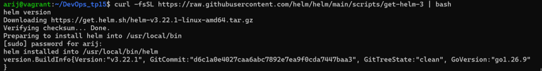

---

### 🟢 Partie 1 : Consommer un chart public
**Installation et inspection du chart public Podinfo (`helm install`, `helm list`) :**
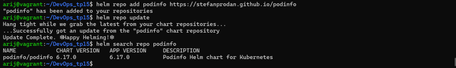
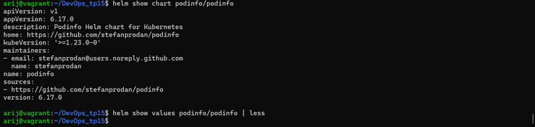

**Vérification de l'historique et des secrets Helm :**
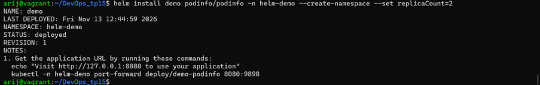
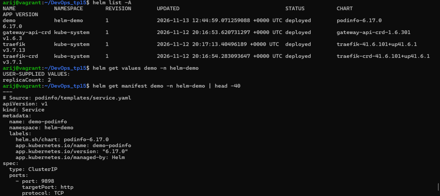

---

### 🟢 Partie 2 : Validation du chart Helm
**Vérification de la syntaxe (`helm lint`) et génération des manifestes (`helm template`) :**
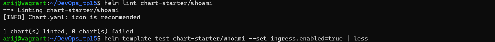

---

### 🟢 Partie 3 : Cycle de vie d'une release Helm
**Historique des déploiements (Upgrade, échec avec l'image v9.9.9 et Rollback vers la révision 2) :**
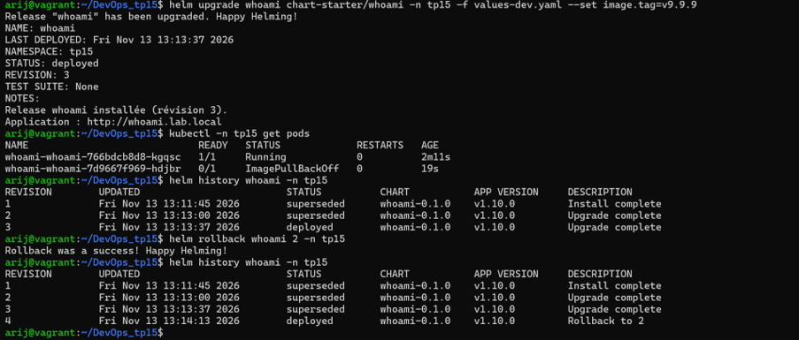

**Test de l'option `--atomic` : Helm annule automatiquement le déploiement suite à l'échec :**
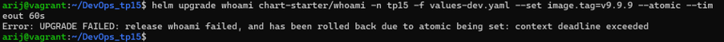

**Packaging du chart (`whoami-0.1.0.tgz`) :**
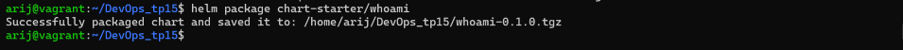

---

### 🟢 Partie 4 : Kustomize (Base et Overlays)
**Prévisualisation de la base et de l'overlay dev (génération de ConfigMap avec hash) :**
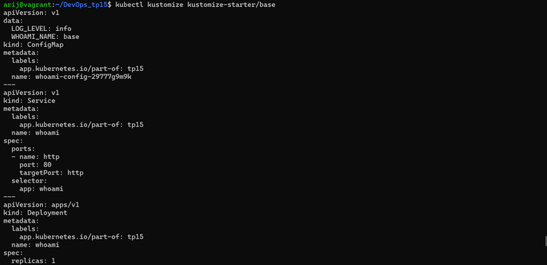

**Déploiement des trois environnements (dev, staging, prod) avec des replicas différents :**
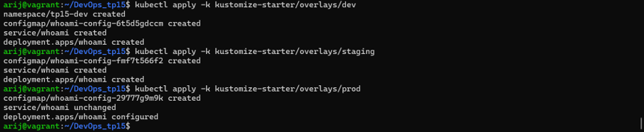
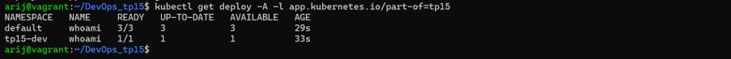

**Comparaison des manifestes générés (`diff`) entre l'environnement de staging et de production :**
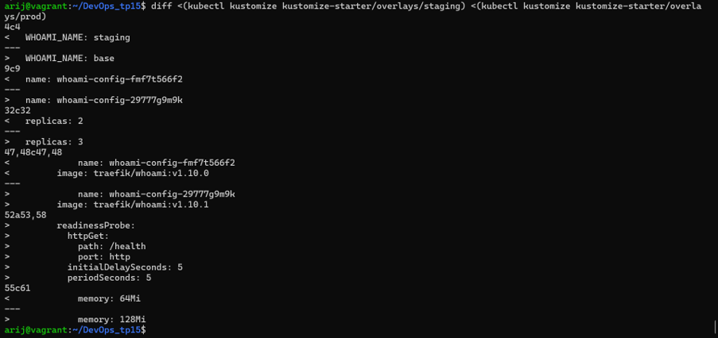

*(Note : Le `diff` montre les changements de replicas (2 vs 3), de tag d'image (v1.10.0 vs v1.10.1), de limite mémoire (64Mi vs 128Mi) et l'ajout de la readinessProbe en production).*

---

## 📊 Partie 5 : Comparaison Helm vs Kustomize

| Critère | Helm | Kustomize |
| :--- | :--- | :--- |
| **Mécanisme (template / patch)** | Template (Go templates) | Patch (Overlays sur une base commune) |
| **Gestion des releases et rollback** | Oui, natif (historique, `helm rollback`) | Non (dépend de Git ou d'ArgoCD pour l'historique) |
| **Distribution d’un logiciel à des tiers** | Excellent (charts packagés `.tgz`) | Moyen (nécessite de partager les fichiers sources) |
| **Lisibilité du YAML final** | Moyenne (beaucoup de `{{ }}` et d'indentations) | Excellente (YAML pur généré) |
| **Intégré à kubectl** | Non (nécessite le binaire `helm`) | Oui (`kubectl apply -k`) |
| **Support par Argo CD** | Oui | Oui |

**Quand utiliser les deux ensemble ?**
> On utilise généralement **Helm** pour déployer des applications tierces complexes (comme Prometheus, Traefik, ou des bases de données) et **Kustomize** par-dessus pour appliquer des patches spécifiques à notre infrastructure (ex: ajouter des annotations, modifier des limites de ressources, ou changer le type de stockage), sans avoir à forker le chart Helm d'origine. 
> Techniquement, Kustomize permet d'intégrer un chart Helm directement dans un `kustomization.yaml` en utilisant le champ `helmCharts:`, ce qui combine le meilleur des deux mondes.

---

## 🧠 Réponses aux questions théoriques

**1. Où Helm stocke-t-il l'historique d'une release ?**
> Helm stocke l'historique dans des **Secrets Kubernetes** (type `helm.sh/release.v1`) dans le namespace de la release. Chaque révision est un secret séparé (ex: `sh.helm.release.v1.demo.v1`), ce qui permet de faire des rollbacks.

**2. Que fait l'option `--atomic` lors d'un `helm upgrade` ?**
> Si le déploiement échoue (ex: image inexistante), Helm attend le timeout défini (`--timeout 60s`) et effectue automatiquement un **rollback** vers la dernière version fonctionnelle, évitant ainsi de laisser l'application dans un état instable.

**3. Pourquoi les Pods sont-ils automatiquement recréés quand on modifie une ConfigMap avec Kustomize ?**
> Kustomize utilise `configMapGenerator`. À chaque modification d'une valeur (ex: `LOG_LEVEL`), Kustomize génère un **nouveau nom** pour la ConfigMap (avec un suffixe de hash). Le Deployment détecte ce changement de nom et déclenche automatiquement un `RollingUpdate`.

---

## 🔒 Sécurité et Bonnes Pratiques
- Les fichiers `.tgz` générés par `helm package` sont ignorés via le `.gitignore`.
- Aucun secret (mot de passe, token) n'est présent en clair dans les fichiers de configuration.
